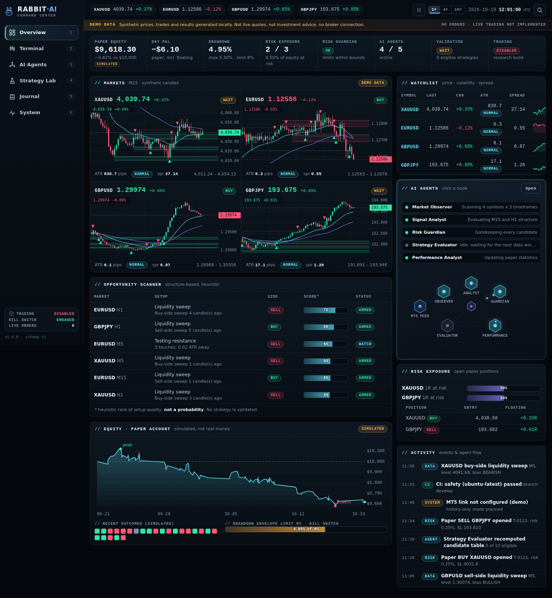

# RABBIT-AI Command Center V1.0

A professional, dark "command center" for the RABBIT-AI research platform: multi-market overview, advanced candlestick terminal,
five AI agents, strategy laboratory, trade journal and system monitor. **Full skeleton first**: every page, chart and panel exists and is
navigable today on **deterministic DEMO data**; the Python/MT5 engine plugs in later through the JSON contracts in `contracts/`.

> **Safety.** This build contains **no live trading and no order code**. Prices, trades, equity and strategy results are
> **synthetic** and labelled DEMO / SIMULATED everywhere. Nothing here is investment advice or evidence of a profitable strategy.
> No paid APIs, no external network requests, no tracking. The frozen V7.2 Python baseline is not part of this project.



## Run

Needs only a browser. ES modules require `http://` (not `file://`):

```bash
python3 scripts/serve.py 8080        # then open http://127.0.0.1:8080/index.html
# or:  npm run serve
```

GitHub Pages: publish the repository root; `command.html` redirects to `index.html#/overview` so the existing URL keeps working.

## Pages

| Route | Page | Highlights |
|---|---|---|
| `#/overview` | Overview / Command Center | KPI strip, 4 market tiles (XAUUSD, EURUSD, GBPUSD, GBPJPY), watchlist, opportunity scanner, agent strip + agent floor, paper equity + drawdown envelope, exposure, activity feed |
| `#/terminal` | Trading Terminal | M1 M5 M15 H1 H4 candles, pan / wheel & pinch zoom / crosshair, EMA, S/R zones, trend lines, liquidity sweeps, trade markers, Entry / SL / TP levels, BUY / SELL / WAIT with explanations and checks, probability only when validated (never in demo), view-only level planner, local CSV import |
| `#/agents` | AI Agents | Market Observer, Signal Analyst, Risk Guardian, Strategy Evaluator, Performance Analyst: state, journal/log, latest decisions with "Why?", risk envelope, animated message topology |
| `#/lab` | Strategy Lab | 10 demo strategies, equity curves with train / validation / frozen-test bands, comparison with 95% CIs, FDR-adjusted p-values, per-symbol parameters validated like the engine (catches the V7.2 XAUUSD unreachable-stop trap), deterministic demo backtest |
| `#/journal` | Trade Journal | simulated trades, statistics, filters, sorting, pagination, detail drawer with chart and local notes, AI decision history, CSV / JSON export |
| `#/system` | System Monitor | MT5 link, per-symbol feed health, GitHub CI / audit status, versions, validation state, logs, safety panel |

Keyboard: `Ctrl/Cmd+K` command palette, `1`-`6` pages, `Space` replay play / pause. Replay re-plays pre-generated synthetic candles (1x / 4x / 16x).

## Test

```bash
npm test                      # 40 unit tests (Node >= 20, no dependencies): domain logic, determinism, contracts, chart geometry, CSV, export
npm run contracts             # regenerate contracts/*.schema.json from src/data/contracts.js
npm run demo-data             # regenerate data/demo/*.json (validated against the contracts)
npm run smoke                 # optional browser smoke test: needs `pip install playwright` + a Chromium
```

The smoke test visits every route on desktop (1440 px) and phone (412 px) viewports and fails on console errors, uncaught exceptions,
horizontal overflow or blank canvases. It also exercises the symbol / timeframe switches, trade drawer, Lab validation and the palette.

## Layout

```
index.html, command.html     entry points (strict CSP: no inline scripts or styles)
src/core/                    dom (safe templating), router, store, formatting, seeded PRNG
src/domain/                  pure logic: indicators, structure, signals, stats, risk, params, csv, export
src/data/contracts.js        JSON contracts + validator (single source of truth)
src/data/provider.js         DemoProvider, HttpProvider, ValidatingProvider
src/data/demo/               deterministic synthetic market, trades, agents, system
src/ui/                      shell, palette, components, charts (canvas), pages
styles/                      tokens, base, layout, components, pages
contracts/ data/demo/        JSON schemas and example payloads for the Python side
tests/ tools/ scripts/       unit tests, browser smoke test, helpers
docs/                        ARCHITECTURE, DESIGN_SYSTEM, INTEGRATION, screenshots
```

See `docs/ARCHITECTURE.md`, `docs/DESIGN_SYSTEM.md` and `docs/INTEGRATION.md` (how GPT-6 connects the Python engine and MT5 data).

## Known limitations

- Zero-dependency ES modules, not Next.js/TypeScript/Tailwind/shadcn as originally discussed. Contracts and the data layer are framework-independent, so a later migration is possible.
- The demo clock replays about 12 hours of pre-generated candles; it is not a live feed.
- `HttpProvider` is covered by unit tests with a fake `fetch` only; it has not been run against a real endpoint.
- CSV import is covered by unit tests, not by a browser upload test.
- Agent-floor pulses use `Math.random()` (visual only); all data is deterministic.
- Windows and Firefox/Safari were not tested; Chromium (headless) on Linux was.
